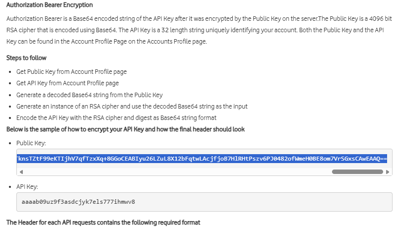

Para ter acesso à API do M-Pesa da Vodacom Moçambique (Developer Portal) e integrar o pagamento no seu backend em Python, você precisa seguir um fluxo formal de registro, criação de aplicativo, geração de credenciais e encriptação da API Key.

Abaixo está o passo a passo detalhado do processo de integração e um script em Python 100% funcional.

## 1. Passo a Passo para Obter Acesso à API do M-Pesa
### Passo 1: Cadastro no Portal de <a href="https://developer.mpesa.vm.co.mz/documentation/">Desenvolvedores</a>


- 1.Acesse o portal oficial: developer.mpesa.vm.co.mz.

* 2.Clique em Register e crie uma conta de desenvolvedor fornecendo os dados solicitados.

* 3.Confirme o seu e-mail para ativar a conta.

## Passo 2: Criar uma Aplicação (My Apps)
- 1.Faça login no portal e vá até a seção My Apps.

* 2.Clique em Add a New App.

- 3.Preencha o nome da sua aplicação e selecione o ambiente Sandbox (para testes).

- 4.O portal vai gerar duas chaves cruciais:

    - API Key: Sua chave privada de acesso.

    - Public Key (OpenSSL RSA): A chave pública fornecida pela Vodacom usada para criptografar a sua API Key.

## Passo 3: Entender a Criptografia da Chave (Authorization Header)

Diferente de outras APIs REST comuns que utilizam tokens estáticos, a API do M-Pesa exige que a sua API Key seja criptografada via RSA (PKCS#1 v1.5) usando a Public Key do M-Pesa e depois convertida em Base64.

- Essa string em Base64 é o que você envia no cabeçalho 
> Authorization: Bearer <token_base64>.

# 2. Parâmetros Obrigatórios da Transação (C2B - Customer to Business)

Para solicitar um pagamento no celular do cliente (STK Push):

- **Service Provider Code (Shortcode)**: O número da sua carteira de negócio (no Sandbox use 171717).

- **Customer MSISDN:** O número de telefone do cliente (deve começar com o código do país 258, ex: 258841234567).

- **Amount**: O valor da transação.

- **Third Party Reference**: O ID único da transação gerado pelo seu sistema (ex: TX-12345).

- **Transaction Reference**: Referência curta da transação (ex: T12344C).

# 3. Código Funcional em Python (Integração C2B / STK Push)

> uv add pycryptodome requests

```python

"mpesa_service.py"

import base64
import requests
from Crypto.Cipher import PKCS1_v1_5
from Crypto.PublicKey import RSA


class MpesaService:

    def __init__(
        self, api_key: str, public_key_pem: str, env: str = "sandbox"
    ):
        """Inicializa o serviço do M-Pesa Vodacom Moçambique.

        :param api_key: A sua API Key gerada no Developer Portal
        :param public_key_pem: A Public Key em formato PEM fornecida pela Vodacom
        :param env: 'sandbox' ou 'production'
        """
        self.api_key = api_key
        self.public_key_pem = public_key_pem

        if env == "sandbox":
            self.base_url = "https://api.sandbox.vm.co.mz"
            self.port = "18352"
        else:
            self.base_url = "https://api.vm.co.mz"
            self.port = "18345"

    def _generate_bearer_token(self) -> str:
        """Criptografa a API Key com a Chave Pública usando RSA PKCS#1 v1.5 e

        converte para Base64.
        """
        try:
            # 1. Carrega a Chave Pública
            key = RSA.import_key(self.public_key_pem)
            cipher = PKCS1_v1_5.new(key)

            # 2. Criptografa a API Key (convertida para bytes)
            encrypted_bytes = cipher.encrypt(self.api_key.encode("utf-8"))

            # 3. Converte o resultado para string Base64
            token_base64 = base64.b64encode(encrypted_bytes).decode("utf-8")
            return token_base64
        except Exception as e:
            raise RuntimeError(
                f"Erro ao gerar o token de autorização: {str(e)}"
            )

    def c2b_payment(
        self,
        phone_number: str,
        amount: float,
        reference_id: str,
        service_provider_code: str = "171717",
    ) -> dict:
        """Inicia um pagamento C2B (STK Push para o celular do cliente)."""
        # Garante o formato 25884XXXXXXX
        clean_phone = phone_number.replace("+", "").strip()
        if not clean_phone.startswith("258"):
            clean_phone = f"258{clean_phone}"

        # Gera o Token Criptografado
        bearer_token = self._generate_bearer_token()

        url = f"{self.base_url}:{self.port}/ipg/v1x/c2bPayment/singleStage/"

        headers = {
            "Content-Type": "application/json",
            "Authorization": f"Bearer {bearer_token}",
            "Origin": "developer.mpesa.vm.co.mz",
        }

        payload = {
            "input_TransactionReference": reference_id[:10],
            "input_CustomerMSISDN": clean_phone,
            "input_Amount": str(amount),
            "input_ThirdPartyReference": reference_id,
            "input_ServiceProviderCode": service_provider_code,
        }

        print(f"[M-Pesa] Enviando cobrança de {amount} MT para {clean_phone}...")

        try:
            response = requests.post(
                url, json=payload, headers=headers, timeout=30
            )

            # O M-Pesa retorna HTTP 201 Created quando o STK Push é enviado com sucesso
            if response.status_code in [200, 201]:
                return {
                    "success": True,
                    "data": response.json(),
                    "status_code": response.status_code,
                }
            else:
                return {
                    "success": False,
                    "error": response.text,
                    "status_code": response.status_code,
                }

        except requests.exceptions.RequestException as e:
            return {"success": False, "error": f"Erro de conexão: {str(e)}"}


# ==========================================
# EXEMPLO DE USO PRÁTICO
# ==========================================
if __name__ == "__main__":
    # 1. Substitua pela sua API Key obtida no portal
    MY_API_KEY = "sua_api_key_aqui"

    # 2. Substitua pela Public Key fornecida no portal do M-Pesa (formato PEM)
    PUBLIC_KEY_SANDBOX = """-----BEGIN PUBLIC KEY-----
MIGfMA0GCSqGSIb3DQEBAQUAA4GNADCBiQKBgQC+... (cole a chave completa aqui)
-----END PUBLIC KEY-----"""

    # Instância do Serviço
    mpesa = MpesaService(
        api_key=MY_API_KEY, public_key_pem=PUBLIC_KEY_SANDBOX, env="sandbox"
    )

    # Executa um teste de cobrança de 50 MT
    resultado = mpesa.c2b_payment(
        phone_number="841234567",
        amount=50.0,
        reference_id="REF12345678",
        service_provider_code="171717",
    )

    print("Resultado da Operação:")
    print(resultado)
```

# Como configurar o endpoint de Webhook em Python para receber a resposta do M-Pesa quando o cliente digita o PIN?

```c
[ Cliente digita o PIN no Celular ]
               │
               ▼
   [ Servidores do M-Pesa ]
               │  (Faz requisição POST HTTP)
               ▼
[ Seu Webhook: POST /api/v1/payments/webhook/mpesa ]
               │
               ▼
[ Atualiza Banco de Dados & Libera Acesso ao Wi-Fi ]
```

## 1. Implementação do Webhook no FastAPI (main.py)
Adicione este código ao seu projeto Python para processar os dados enviados pelo M-Pesa:

```python
from enum import Enum
from typing import Optional
from fastapi import FastAPI, BackgroundTasks, HTTPException, Request, status
from pydantic import BaseModel, Field

# Modelos do Payload retornado pelo M-Pesa no Webhook
class MpesaCallbackResponse(BaseModel):
    input_TransactionReference: str = Field(..., description="Referência única gerada no checkout")
    input_ThirdPartyReference: str = Field(..., description="ID de referência do seu sistema")
    input_ResponseCode: str = Field(..., description="INS-0 para Sucesso")
    input_ResponseDesc: str = Field(..., description="Descrição da resposta do M-Pesa")
    input_TransactionID: Optional[str] = Field(None, description="ID da transação M-Pesa (ex: MpesaID)")
    input_CustomerMSISDN: Optional[str] = None
    input_Amount: Optional[str] = None


# Função auxiliar para liberar a internet do usuário após confirmação
def process_successful_payment(transaction_id: str, mpesa_code: str):
    print(f"=== [PAGAMENTO CONFIRMADO] ===")
    print(f"Ref Sistema: {transaction_id}")
    print(f"ID M-Pesa: {mpesa_code}")
    
    # 1. Atualizar o status da transação no Banco de Dados para 'COMPLETED'
    # 2. Localizar o usuário e chamar a função de liberação de rede (iptables / MikroTik)
    # 3. Ex: activate_user_network_access(mac_address, ip_address, speed_mbps)


@app.post("/api/v1/payments/webhook/mpesa", status_code=status.HTTP_200_OK)
async def mpesa_webhook(
    payload: MpesaCallbackResponse, 
    background_tasks: BackgroundTasks
):
    """
    Endpoint chamado pelos servidores da Vodacom M-Pesa assim que
    o cliente digita o PIN no celular.
    """
    print(f"[WEBHOOK M-PESA] Recebido callback para Ref: {payload.input_ThirdPartyReference}")
    
    # INS-0 indica que a transação foi concluída com sucesso
    if payload.input_ResponseCode == "INS-0":
        # Executa a liberação do acesso em segundo plano para responder rápido ao M-Pesa
        background_tasks.add_task(
            process_successful_payment,
            transaction_id=payload.input_ThirdPartyReference,
            mpesa_code=payload.input_TransactionID or "N/A"
        )
        return {
            "result": "Success",
            "message": "Pagamento processado e acesso liberado."
        }
    else:
        print(f"[WEBHOOK M-PESA] Falha no pagamento: {payload.input_ResponseDesc}")
        # Tratar casos de PIN incorreto, saldo insuficiente ou cancelamento pelo usuário
        return {
            "result": "Failed",
            "message": f"Transação não concluída: {payload.input_ResponseDesc}"
        }
        ````

CHECJ IT OUT
https://clicpay.co.mz/api/documentation#carteiras-GETapi-v2-me-wallets